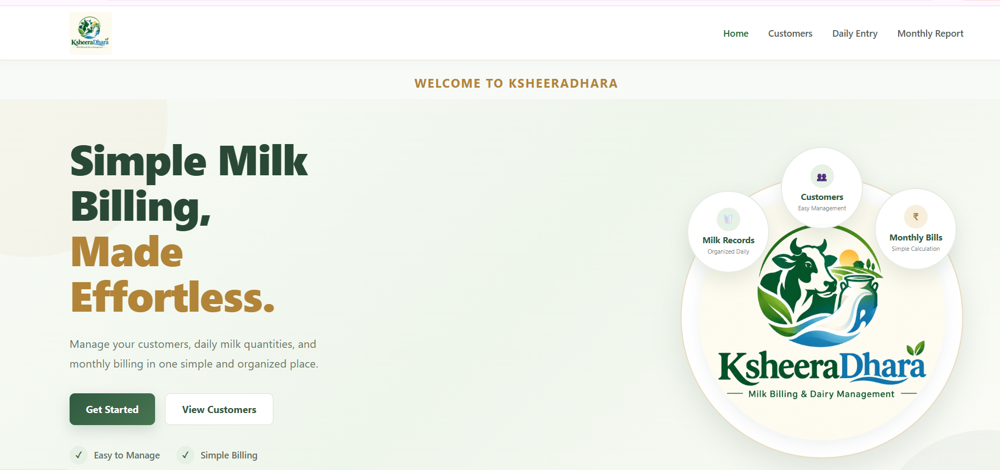

# 🥛 KsheeraDhara – Milk Billing System

A simple web application built with Python and Flask to manage milk customers, track daily milk consumption, and calculate monthly bills.

KsheeraDhara helps milk suppliers organize customer records and billing in one place, reducing manual calculations and making monthly billing easier.

## 📌 The Problem It Solves

Managing milk bills manually can be time-consuming, especially when customers receive different quantities of milk or skip certain days.

KsheeraDhara simplifies this process by organizing customer details, recording daily milk changes, and calculating monthly bills automatically.

## ✨ Features

### 👥 Customer Management
- Add customers and manage their details.
- Set daily milk quantity and price per liter.
- Record each customer's starting date.

### 🥛 Daily Milk Entry
- Record changes in daily milk quantity.
- Use the default quantity when no change is recorded.
- Record no-milk days with a reason.

### 📊 Monthly Milk Report
- Select a customer and month to view the bill.
- Calculate total milk consumption and amount payable.
- Review milk-taking days, no-milk days, and extra quantities.
- Calculate the billing period based on the customer's starting date and selected month.

### 📋 Previous Month Bills
- View pending bills from the previous month.
- Open individual bills to review billing details.
- Mark bills as paid and clear the relevant previous-month records after payment.

### 🎨 User Interface
- Consistent KsheeraDhara branding and navigation.
- Clear presentation of customer details and billing information.
- Responsive styling for different screen sizes.

## 🖥️ Screenshots

Screenshots of the application are provided below to demonstrate its main pages and features.

### Home Page


> **Note:** Save your actual application screenshots in the `screenshots` folder using the filenames shown above. GitHub will display them when the files are uploaded.

## 🔄 How It Works

1. **Add a customer:** Enter customer details, default daily milk quantity, price per liter, and starting date.
2. **Record daily changes:** Enter a record when the supplied quantity changes or no milk is supplied.
3. **Generate a monthly report:** Select a customer and month to calculate total milk consumption and the amount payable.
4. **Review previous bills:** View pending bills and check individual billing details.
5. **Clear after payment:** Mark the bill as paid and clear the relevant previous-month records.

## 🛠️ Technologies Used

| Technology | Purpose |
|---|---|
| Python | Application logic and billing calculations |
| Flask | Web application framework |
| HTML | Page structure |
| CSS | Styling and responsive layout |
| JavaScript | Client-side interactions, where needed |
| JSON | Local storage of application records |

## 📁 Project Structure

<details>
<summary>View complete project structure</summary>
``` text
milk_app/
├── app.py
├── README.md
├── .gitignore
├── customers.json
├── daily_entries.json
├── monthly_bills.json
├── cleared_bills.json
├── templates/
│   ├── index.html
│   ├── add_customer.html
│   ├── customers.html
│   ├── daily_entry.html
│   ├── monthly_report.html
│   ├── previous_month_bills.html
│   └── previous_bill_detail.html
├── static/
│   ├── style.css
│   └── images/
│       └── ksheeradhara-logo.png
└── screenshots/
    ├── home.png
    
```
</details>

### JSON Files

- `customers.json` – Customer information.
- `daily_entries.json` – Daily milk entry records.
- `monthly_bills.json` – Monthly billing records.
- `cleared_bills.json` – Cleared bill records.

The `templates` folder contains the HTML pages, while the `static` folder contains the stylesheet and logo.

**Sample data:** The JSON files included in this repository contain fictional data for demonstration and testing. They do not represent actual customer records.

When using the application with real customers, keep their information private and maintain backups of important records.

## 🚀 Getting Started

Follow these steps to run the application locally.

### Prerequisites

- Python installed on your computer.
- Git installed to clone the repository.

### 1. Clone the Repository

bash
git clone YOUR_REPOSITORY_URL


### 2. Open the Project Folder

bash
cd milk_app


### 3. Create and Activate a Virtual Environment

powershell
python -m venv venv
.\venv\Scripts\Activate.ps1


### 4. Install Flask

bash
python -m pip install Flask


### 5. Run the Application

bash
python app.py


Open the following address in your browser:

http://127.0.0.1:5000/

## 💾 Data Storage

KsheeraDhara uses JSON files to store customer details, daily entries, monthly bills, and cleared-bill records. It does not require a separate database server.

Because data is stored locally, keep backups and avoid sharing real customer or billing information publicly.

## 🌱 Project Background

KsheeraDhara is Version 2 of my original Milk Billing System. This version introduces improved branding, a consistent interface, and dedicated pages for daily entries, monthly reports, and previous bills.

The project demonstrates how Python, Flask, HTML, CSS, JavaScript, and JSON can be used to solve a practical everyday billing problem.

## 👩‍💻 Author

Developed as a practical web application project to simplify milk billing and customer record management.

---

**Project:** KsheeraDhara – Milk Billing System  
**Version:** 2
